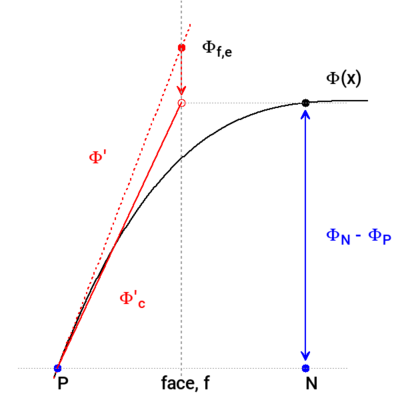

<!-- https://doc.openfoam.com/2606/tools/processing/numerics/schemes/gradient/rtm/cellLimited/ -->

# Cell\-limited gradient scheme

## Properties

The cell gradient is limited to ensure that the face values obtained by
extrapolating the cell value to the cell faces using the gradient are bounded
by the neighbouring cells minimum and maximum limits.

As an example, consider the limiter to apply between cells P and N.



The value of ϕP\\phi\_PϕP​ is extrapolated using the gradient at P to the cell
face ϕf,e\\phi\_{f,e}ϕf,e​. When using a coefficient of 1, if the extrapolated
value exceeds the value of the neighbour value ϕN\\phi\_NϕN​ the gradient is
scaled so as to achieve ϕN\\phi\_{N}ϕN​.

## Usage

The scheme is specified using:

```
gradSchemes
{
    default         none;
    grad(U)         cellLimited <scheme> <coefficient>;
}

```

The coefficient should be specified in the range zero to one, where values of

* 1 represent limiting the gradient to ensure the extrapolated face value is
bounded by the minimum and maximum neighbour cell values
* smaller values allow variation the extrapolated value to exceed the neighbour
cell limiting values by a multiple of
max(ϕN)−min(ϕN)\\mathrm{max}(\\phi\_N) \- \\mathrm{min}(\\phi\_N)max(ϕN​)−min(ϕN​)

## Further information

Source code

* [Foam::fv::cellLimitedGrad](https://api.openfoam.com/2606/Foam_fv_cellLimitedGrad.html)

Mult\-directional form

* [cellMDLimited](../cellMDLimited.md)
