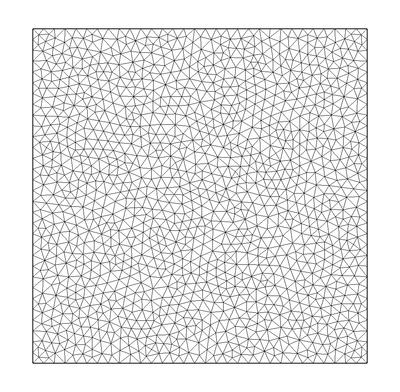

<!-- https://doc.openfoam.com/2606/tools/processing/numerics/schemes/time/example -->

# Time scheme example

* Solver: [scalarTransportFoam](../../../solvers/rtm/basic/scalarTransportFoam/index.md)
* TODO: Repository link: TBA

## Introduction

The test case comprises a 2\-D box section, across which a uniform flow
is applied. A passive scalar is introduced in a circular region at the start
time, and transported across the domain. By looking at the profile of the
scalar across the section, we can determine the characteristics of our
time scheme selection.

## Case set\-up

The impact of the choice of time scheme is assessed by
varying the `ddt` scheme entry of the [fvSchemes](../../../../../fundamentals/case-structure/fvschemes/index.md) file:

```
ddtSchemes
{
    ddt(phi)        <time scheme>
}

```

### Boundary conditions

Velocity boundary conditions

| Patch | Type | Value |
| --- | --- | --- |
| left | fixedValue | (1,1,0\) |
| right | zeroGradient |  |
| top | zeroGradient |  |
| bottom | fixedValue | (1,1,0\) |
| frontAndBack | empty |  |

Scalar boundary conditions

| Patch | Type | Value |
| --- | --- | --- |
| left | fixedValue | 0 |
| right | zeroGradient |  |
| top | zeroGradient |  |
| bottom | fixedValue | 0 |
| frontAndBack | empty |  |

![Initial field]()

### Mesh



## Results

### Euler results


### backward results


### Crank\-Nicolson results


