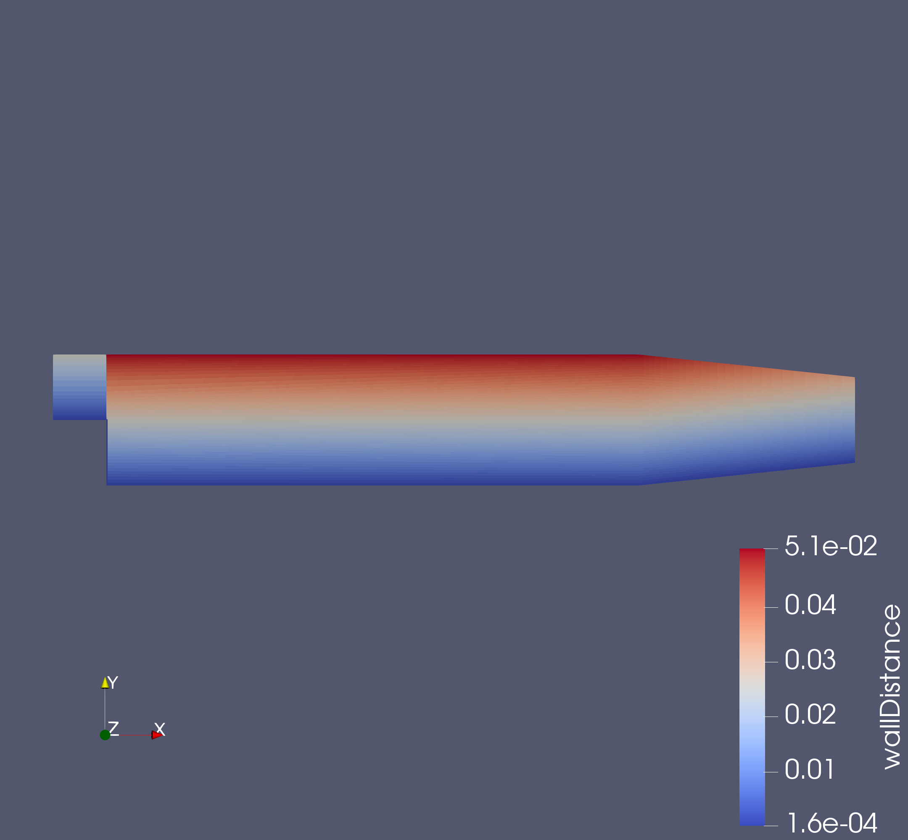

<!-- https://doc.openfoam.com/2606/tools/processing/numerics/schemes/wall-distance/rtm/directionalMeshWave -->

# Directional mesh\-wave wall distance

## Properties

`directionalMeshWave` is a variant of
[meshWave](meshWave.md) distance\-to\-patch
calculation method, with which the distance component in a specified direction
can be ignored, e.g. the distance\-to\-patch can be computed in the wall\-normal
direction only.

For a given point within a given mesh, the existing `meshWave` method gives
the orthogonal distance to a specified patch. In meshes with very steep terrain
(e.g. a hill of 90 \[`deg`]), this might be problematic for the fields that
require the distance to the patch associated with the terrain surface.

An example of `directionalMeshWave` output in terms of the wall distance
can be seen as follows:



## Usage

Example specification of `directionalMeshWave` method
in `system/fvSchemes.wallDist`:

```
wallDist
{
    // Mandatory entries (unmodifiable)
    method      directionalMeshWave;
    normal      (0 0 1);

    // Optional (inherited) entries (unmodifiable)
    ...
}

```

| Property | Description | Type | Required | Default |
| --- | --- | --- | --- | --- |
| method | Method name: directionalMeshWave | word | yes | \- |
| normal | The direction component to ignore | vector | yes | \- |

The inherited entries are elaborated in:

* [meshWavePatchDistMethod](meshWave.md)

## Further information

Tutorial:

* [SnakeRiverCanyon](https://gitlab.com/openfoam/core/openfoam/-/tree/OpenFOAM-v2606/tutorials/mesh/moveDynamicMesh/SnakeRiverCanyon)

Source code

* [Foam::patchDistMethods::directionalMeshWave](https://api.openfoam.com/2606/Foam_patchDistMethods_directionalMeshWave.html)

**History:** Introduced in version [v2006](https://www.openfoam.com/news/main-news/openfoam-v2006)
