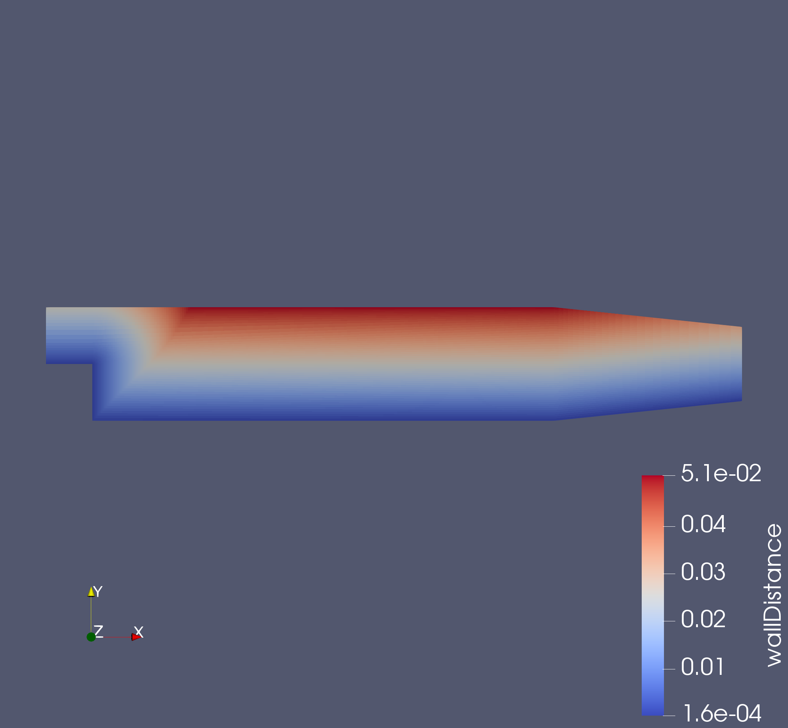

<!-- https://doc.openfoam.com/2606/tools/processing/numerics/schemes/wall-distance/rtm/meshWave -->

# Mesh\-wave wall distance (default)

## Properties

Fast topological mesh\-wave method for calculating the distance to nearest
patch for all cells and boundary.

For regular/un\-distorted meshes this method is accurate but for skewed,
non\-orthogonal meshes it is approximate with the error increasing with the
degree of mesh distortion. The distance from the near\-wall cells to the
boundary may optionally be corrected.

An example of `meshWave` output in terms of the wall distance
can be seen as follows:



## Usage

The scheme is specified using:

```
wallDist
{
    method          meshWave;

    // Optionally correct distance from near-wall cells to the boundary
    correctWalls    true;
}

```

## Further information

Source code

* [Foam::patchDistMethods::meshWave](https://api.openfoam.com/2606/Foam_patchDistMethods_meshWave.html)
