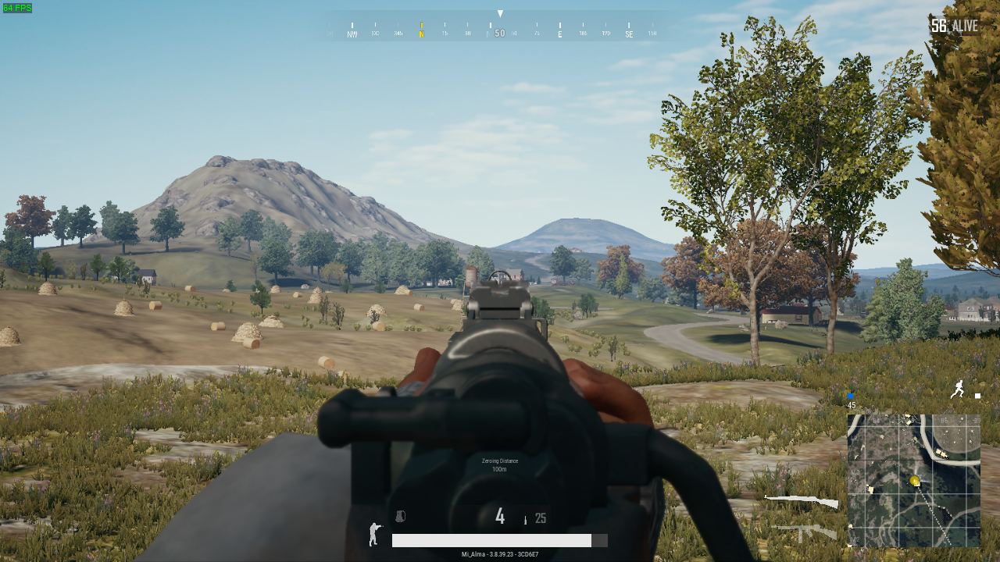

# Combat

- Let players aim and shoot at each other.
- Solid obstacles should block gunfire, and valid hits should reduce the target's health.
- Shooting should consume ammunition according to the weapon-system requirements.
- Give players clear feedback about their health, ammunition, and whether they have been hit.
- Apply each hit once and keep its effect consistent across both clients.

## Reference image

- Use the sight alignment and readable ammunition display as visual guidance. Recoil and damage behavior are defined in the weapon-system instructions.
- Source: PUBG: BATTLEGROUNDS screenshot from the Steam Community guide "PUBG settings & visual for middle-end / low specs pc".

