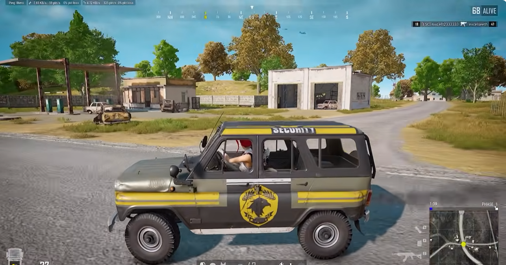

# Driving

- Include a drivable vehicle.
- Players should be able to approach it, enter it, steer, accelerate, brake, and get out again.
- Driving should move the player through the same world used for movement and combat, with collisions against solid obstacles.
- The other player should see the vehicle move and its driver enter or leave.
- Only one player can occupy the driver's seat at a time.

## Reference image

- Use the vehicle's scale, placement on the road, and readable driving HUD as visual guidance. Choose the vehicle and controls.
- Source: PUBG: BATTLEGROUNDS driving screenshot published by Fileion.

