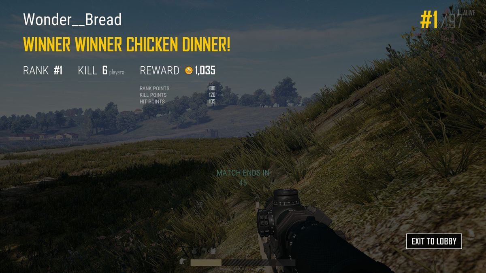

# Elimination and match loop

- When a player's health reaches zero, eliminate them from the match and prevent them from moving, shooting, collecting loot, or driving.
- The last surviving player wins.
- If both players are eliminated together, show a draw.
- Both clients should agree on the result.
- Let the players start another match with fresh health, loot, vehicles, and zone state.

## Reference image

- Use the clear match result and exit-to-lobby action as visual guidance. Rewards, rankings, and statistics shown are not required.
- Source: PUBG: BATTLEGROUNDS victory screenshot published by MobyGames, Windows screenshot 1158353.

