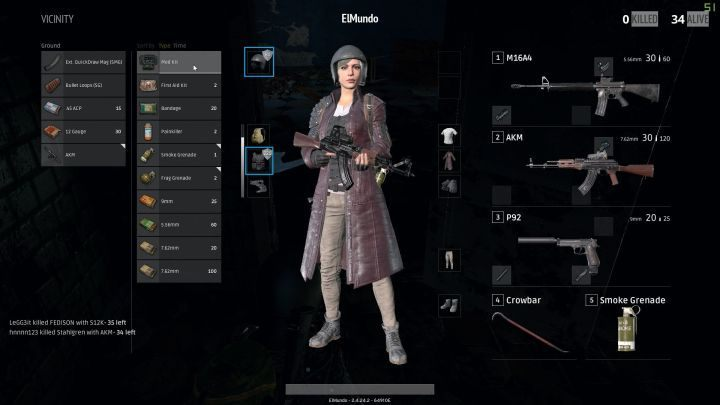

# Looting

- Place weapons and ammunition around the map for players to find and collect.
- Picking up an item should make it available to that player and remove it from the world for both players.
- If both players try to collect the same item, only one should receive it.

## Reference image

- Use the nearby-loot list and distinction between world items and carried equipment as visual guidance. Only the weapons and ammunition specified in this task are required.
- Source: PUBG: BATTLEGROUNDS screenshot published by Gamepressure in "Vests and helmets".

