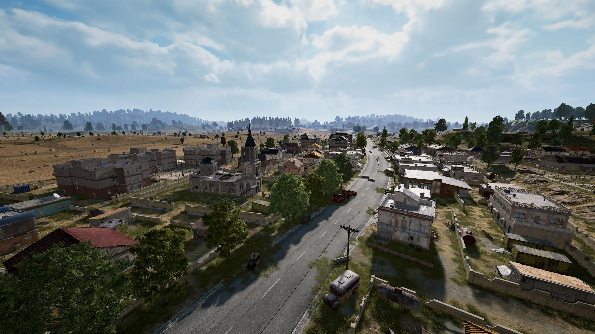

# Map and geography

- Build a realistic outdoor map with terrain, buildings, cover, and connected roads that support movement, combat, looting, and driving.
- Keep player spawns, loot, and vehicles in accessible locations.
- Match visible solid surfaces to collision geometry so players, vehicles, and gunfire cannot pass through solid obstacles.
- Choose the geography and layout for a two-player match.

## Reference image

- Use the settlement, roads, open terrain, and cover as visual guidance. The exact map layout is your choice.
- Source: KRAFTON / PUBG: BATTLEGROUNDS, official Erangel map image.

