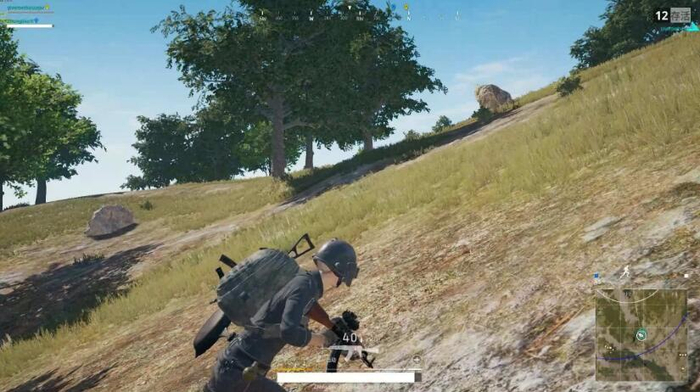

# Movement

- Let each player move their own character around the map and look around using responsive controls.
- Respect solid obstacles and terrain so characters remain in the playable world.
- Make the character model and animations follow movement, and show that movement consistently on the other client.
- Choose and document the movement controls and camera perspective.

## Reference image

- Use the character scale, ground contact, and relationship to nearby cover as visual guidance. The camera angle and crouching pose shown are illustrative.
- Source: PUBG: BATTLEGROUNDS screenshot published by Sina News in its March 24, 2018 region-server article.

