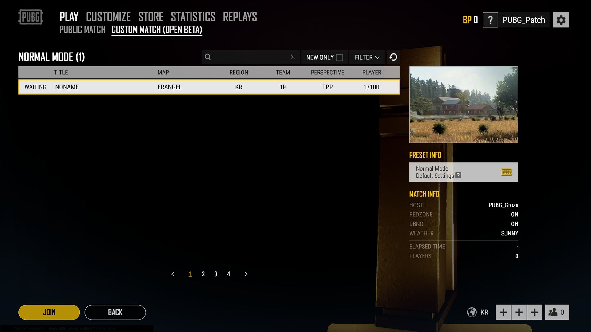

# Multiplayer

- Support two human players on separate game clients, joining the same match and playing as opponents.
- Give them a way to join and start a match from within the game.
- Each player controls only their own character.
- Show the opponent only when they are visually present in the player's view. Opaque objects must occlude them.
- Do not show the opponent's location on the in-game map.
- Keep shared gameplay state consistent across both clients, including loot ownership, combat results, vehicles, and match outcomes.

## Reference image

- Use the join flow, waiting status, and participant count as interface guidance. This task requires only two opposing players; the extra modes, regions, and spectator options shown are not required.
- Source: KRAFTON / PUBG: BATTLEGROUNDS, Steam announcement "Custom Match Update - Open Beta Test".

