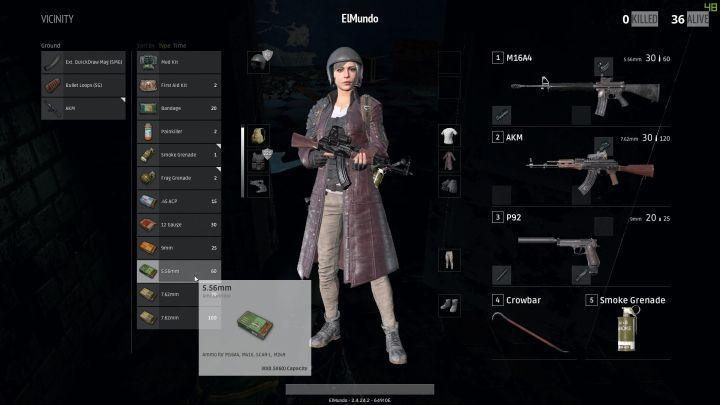

# Package organization: backpack and inventory

- Provide an inventory interface that shows the weapons and reserve ammunition the player carries.
- Support carrying the AK-47 and M16 together, with one equipped at a time, as specified in the weapon-system instructions.
- Keep each rifle's loaded ammunition separate from reserve ammunition and preserve those counts when switching weapons.
- Update the inventory when the player collects loot or reloads. Items belong to the player who collected them.

## Reference image

- Use the separation between nearby items, carried supplies, and equipped weapons as interface guidance. Extra equipment, attachments, and consumables shown are not required.
- Source: PUBG: BATTLEGROUNDS screenshot published by Gamepressure in "Selecting the right weapons".

