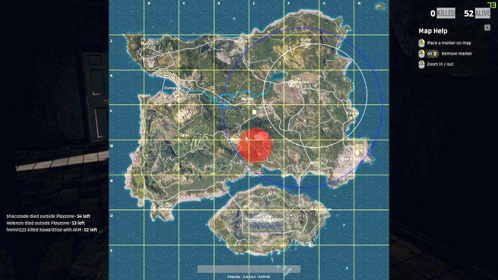

# Shrinking zone

- The safe zone should shrink as the match progresses.
- Show players where it is and when it will shrink next.
- Players outside it should take damage, including while driving, so staying outside eventually eliminates them.

## Reference image

- Use the safe-area boundary and map readability as visual guidance. Extra danger zones, annotations, and player counts shown do not add requirements.
- Source: PUBG: BATTLEGROUNDS screenshot published by Gamepressure in "Fighting zones - white and blue zones".

