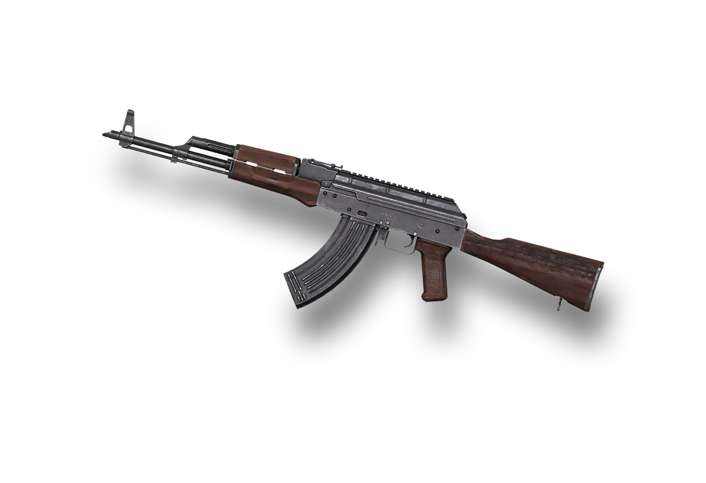
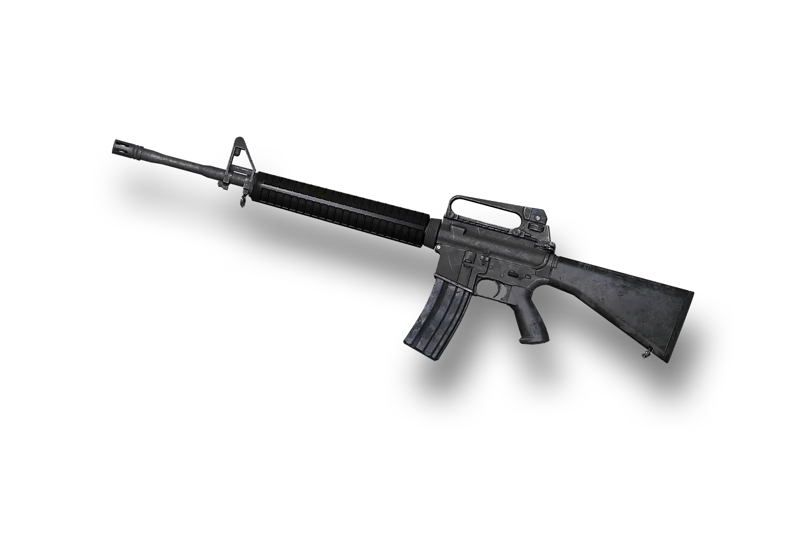

# Weapon system

### Visual references

- Use the images in this folder as guidance for weapon proportions, materials, and recognizable silhouettes. Both images are available locally; no download is needed.
- Image source: KRAFTON / PUBG: BATTLEGROUNDS official assault-rifle reference.
- The AKM is a related visual reference for the requested AK-47; the M16A4 is the reference for the requested M16. Keep the weapon names and gameplay behavior specified below.
- Exact texture matching is not required. These images guide appearance; firing modes, damage, ammunition, and reload behavior follow this prompt.

AKM reference (KRAFTON / PUBG: BATTLEGROUNDS):

M16A4 reference (KRAFTON / PUBG: BATTLEGROUNDS):

### Rifles

- Include an AK-47 and an M16, each with a recognizable model visible in the player's hands and to the opponent when they are in view.
- For this game, the AK-47 fires automatically while the trigger is held, stopping when the trigger is released or the magazine is empty.
- The M16 fires one shot per trigger press. Holding the trigger should not produce additional shots.
- Give the AK-47 stronger recoil and higher damage per hit than the M16. Make the M16 easier to control for deliberate, repeated shots.
- Define each rifle's damage, maximum fire rate, magazine capacity, reload duration, and recoil. Choose and document the values as game-balance settings, and apply them consistently to both players.

### Equipping and aiming

- Let a player carry both rifles, with only one equipped at a time. Provide controls to switch between them.
- Preserve each rifle's remaining magazine ammunition when switching away from it and back.
- Support firing from the hip and aiming down the equipped rifle's sights. Aiming down sights should narrow the shot spread and align the sight with the intended firing direction.
- Apply recoil to the player's aim when firing. Repeated shots should require the player to compensate, and the recoil offset should settle when firing stops.
- Prevent firing while switching weapons, reloading, or driving, and after elimination.

### Ammunition and reloading

- Track loaded magazine ammunition separately for each rifle and track compatible reserve ammunition in the inventory.
- Each shot consumes one loaded round. Enforce the fire-rate limit even if the player presses the fire button rapidly.
- An empty rifle cannot fire or cause damage. Give the player an empty-magazine indication when they try.
- Let players reload a partially filled or empty magazine when compatible reserve ammunition is available.
- A completed reload transfers only enough rounds to fill the magazine, or all remaining compatible reserve rounds if fewer are available. Preserve ammunition already in the magazine.
- Switching weapons cancels an unfinished reload. Transfer ammunition only when the reload completes, so cancellation cannot create or lose rounds.
- Attempting to reload a full magazine or without compatible reserve ammunition should leave ammunition counts unchanged.

### Feedback and multiplayer behavior

- Show the equipped rifle, loaded ammunition, reserve ammunition, and reload progress on the HUD.
- Include muzzle flashes, firing sounds, visible recoil, reload animations, and impact effects where shots strike a surface.
- Keep the weapon model, firing effects, and reload animation consistent with the player's actions. The opponent should see these actions when the player is visible.
- A shot should cause damage only once, and both clients should agree on its effect. Weapon switching or reloading must not reset health, duplicate weapons, or create ammunition.
